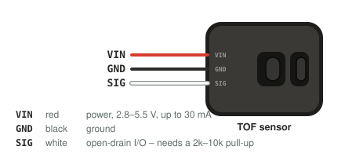
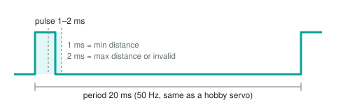
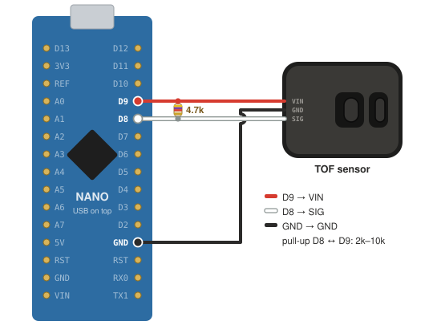
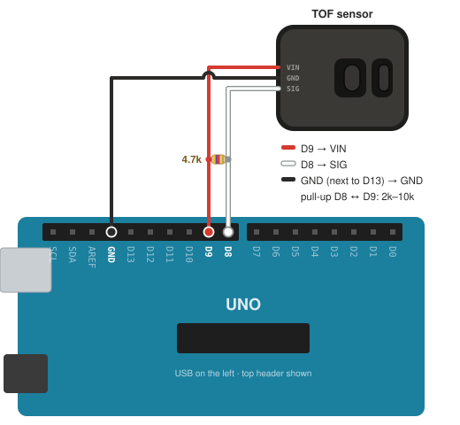
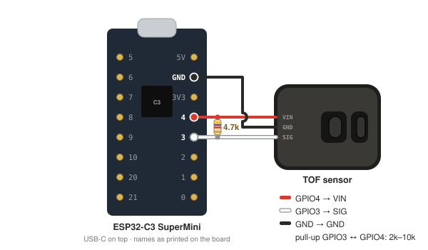
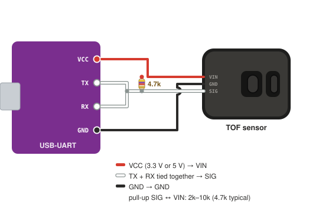

# TOF Distance Sensor

A small time-of-flight distance sensor with a single signal wire. It measures up to
1.2 m with a 940 nm laser and can report the result in three ways: as a digital
on/off output, as a servo-style PWM signal, or over a half-duplex serial line where
every setting can be read and changed.

The full datasheet is in [`TOF distance sensor.pdf`](TOF%20distance%20sensor.pdf).
This page is a shorter summary of it, plus wiring for the common ways to connect
and configure the sensor.

<p align="center"></p>

## Pinout

| Pin | Wire  | Function |
|-----|-------|----------|
| VIN | red   | Supply, 2.8–5.5 V, up to 30 mA |
| GND | black | Ground |
| SIG | white | Signal, open-drain input/output |

SIG is open-drain, so it **always needs a pull-up resistor** to the supply.
2k–10k works in most cases; 4.7k is a good default. Use the lower end for high
serial baud rates or long wires. The pull-up voltage must be at least 2.8 V –
usually you just connect it to the same supply as your microcontroller.

## Specifications

| Parameter | Value |
|-----------|-------|
| Supply voltage | 2.8–5.5 V (5 V typical), absolute max 7 V |
| Supply current | 25 mA typical, 30 mA max |
| Range | up to 1200 mm (needs 50 ms sampling time) |
| Sampling time | 5–50 ms, default 33 ms |
| Wavelength | 940 nm |
| Field of view | 18–22° |
| Start-up time | 10–50 ms |

## Output modes

The I/O mode (register `80`) decides what the SIG pin does. A change only takes
effect after the sensor restarts.

**Digital (mode 1, factory default).** SIG is LOW or HIGH depending on the
detection logic. By default the output is HIGH when the sensor has a valid
measurement, and with the default checks that means something is between 1 and
500 mm away. The detection mode, thresholds and output inversion are all
configurable (registers `BA`–`BD`).

**PWM (mode 2).** SIG outputs a servo-style signal with a 20 ms period. The pulse
is 1 ms at the minimum distance and 2 ms at the maximum distance (registers `B7` /
`B8`). An invalid measurement also gives 2 ms.

<p align="center"></p>

**Serial (mode 0).** SIG becomes a half-duplex UART: 8N1, ASCII commands, 9600 baud
by default. This is the mode used to read measurements and change settings. Several
sensors can share one line, each with its own ID (register `81`).

## Entering serial mode

A new sensor starts in Digital mode, so to configure it you first force it into
serial mode:

1. Disconnect the sensor's power.
2. Hold SIG low (short it to GND, or drive it LOW from a microcontroller).
3. Reconnect power and wait at least 50 ms.
4. Release SIG.

The sensor is now in serial mode at **9600 baud with ID 00**. This is temporary: on
the next restart it goes back to the mode stored in its memory. To keep serial mode,
set I/O mode to 0 and save the configuration.

## Configuring the sensor

The easiest way is the [SoBotz TOF Sensor Tool](https://sobotz.com/M60F_Sensor_Tool.html),
which runs in Chrome or Edge and talks to the sensor over USB. It shows live
readings and lets you edit and save every setting. It works with a USB-UART adapter,
or with an Arduino or ESP32 used as a programmer.

### With an Arduino or ESP32 (recommended)

The board runs the `TOF_Programmer` sketch (download it from the tool, or use
[`Examples/TOF_Programmer`](Examples/TOF_Programmer)). It powers the sensor from one
of its pins, which lets it restart the sensor and put it into serial mode by itself,
so you never have to short SIG by hand.

Power the sensor from the board's pin, **not** from 5V or 3.3V, and connect the
pull-up to that same pin. One pin is enough: the sensor is only powered this way
while you configure it.

<table>
<tr>
<td align="center"><b>Arduino Nano</b><br></td>
<td align="center"><b>Arduino Uno</b><br></td>
</tr>
</table>

| Arduino Nano / Uno | Sensor |
|--------------------|--------|
| D9 | VIN |
| D8 | SIG |
| GND | GND |
| pull-up resistor | between D8 and D9 |

On the Arduino, SIG has to be on D8 because the
[SingleWireSerial](https://github.com/felias-fogg/SingleWireSerial) library (install
it from the Library Manager) can only receive on that pin.

<p align="center"></p>

| ESP32-C3 SuperMini | Sensor |
|--------------------|--------|
| GPIO4 | VIN |
| GPIO3 | SIG |
| GND | GND |
| pull-up resistor | between GPIO3 and GPIO4 |

Any ESP32 works (ESP32, S2, S3, C3, C6…) and no extra library is needed. To use
other pins, change `ESP_SIG_PIN` and `ESP_PWR_PINS` at the top of the sketch, and
avoid the strapping pins (C3: 2, 8, 9; ESP32: 0, 2, 5, 12, 15). On boards with
native USB, enable *USB CDC On Boot* in the Arduino IDE. A 3.3 V pin drops to about
3 V under the sensor's load, which is still above the 2.8 V minimum. If the sensor
keeps restarting, add a second power pin.

### With a USB-UART adapter

Tie the adapter's TX and RX together and connect them to SIG. Here you have to enter
serial mode by hand, as described above.

<p align="center"></p>

Some adapters drive TX so hard that the sensor can't pull the line low to answer.
If you see your own commands echo back but never a reply, put a 1k–2.2k resistor in
the TX wire, or use an Arduino or ESP32 instead.

## Using the sensor in your own code

The [`Examples`](Examples) folder has Arduino sketches for the two ways of reading
the sensor from a microcontroller: over the serial line, or by measuring the PWM
output.

### Serial examples (Arduino Nano / Uno)

Both serial examples use [`DistanceSensor.h`](Examples/Arduino%20nano%20%28single%20wire%20serial%29/SensorExample/DistanceSensor.h),
a small helper class that wraps the serial protocol, together with the
[SingleWireSerial](https://github.com/felias-fogg/SingleWireSerial) library. SIG goes
to **D8** (the only pin the library can receive on), with a pull-up to the sensor's supply.

```cpp
#include <SingleWireSerial.h>
#include "DistanceSensor.h"

SingleWireSerial oneWire(false);         // single-wire mode, uses D8 and Timer1
DistanceSensor sensor(&oneWire, 0);      // sensor with ID 00

void setup() {
  Serial.begin(9600);
  oneWire.begin(9600);
  oneWire.setTimeout(10);
  sensor.waitForBoot();                  // waits until the sensor answers
}

void loop() {
  Serial.println(sensor.readDistance_mm());   // 0xFFF = invalid
  delay(100);
}
```

| Function | What it does |
|----------|--------------|
| `readDistance_mm()` / `readDistance_cm()` | distance; returns `0xFFF` / `0xFF` if invalid or no reply |
| `readRegister(reg, &value)` | read any register; returns `false` on no reply |
| `writeRegister(reg, value)` | write a register; `true` if the sensor answered `A` |
| `saveConfiguration()` | store the current settings in the sensor's memory |
| `resetConfiguration()` | restore the factory defaults |
| `rsetartSensor()` | restart the sensor (name as spelled in the header) |
| `waitForBoot(timeout_ms)` | poll until the sensor answers, default 500 ms |

**[`SensorExample`](Examples/Arduino%20nano%20%28single%20wire%20serial%29/SensorExample)**
reads the distance and prints it to the serial monitor every 100 ms. At startup it holds
D8 low for 500 ms, so if the Arduino and the sensor are powered up together the sensor
starts in serial mode even when it is configured for Digital or PWM. The commented-out
lines show how to read three sensors on the same wire, each with its own ID.

**[`ConfigurationExample`](Examples/Arduino%20nano%20%28single%20wire%20serial%29/ConfigurationExample)**
configures the sensor from code. VIN is powered from **D3**, so the sketch can restart the
sensor by itself: it forces serial mode, resets the configuration to defaults, restarts
the sensor, sets I/O mode to Serial and ID to 00, saves, and then prints the distance in
a loop. Change the `writeRegister` lines to set up your own configuration.

| Arduino | SensorExample | ConfigurationExample |
|---------|---------------|----------------------|
| D8 | SIG | SIG |
| VIN source | 5V | D3 |
| pull-up | SIG to 5V | SIG to D3 |
| GND | GND | GND |

### PWM example (any Arduino)

**[`PWM_Example`](Examples/Arduino%20pwm%20%28pulseIn%29/PWM_Example)** reads the
sensor in PWM mode with `pulseIn()`. It needs no library and works on any pin (D8 in the
sketch). Set the sensor to PWM mode first (I/O mode 2, then save), and power it from 5V
with SIG pulled up to 5V.

The pulse width is converted to millimetres:

```
distance_mm = (pulse_us - 1000) * MAX_DISTANCE_MM / 1000
```

`MAX_DISTANCE_MM` must match the sensor's max distance setting (register `B8`, 500 mm by
default). Because 2 ms means both "at max distance" and "invalid measurement", PWM
can't tell those two apart. Use serial mode if you need to know. Real sensors may not hit
exactly 1000 and 2000 µs; the sketch keeps both limits as defines so you can tune them.

### Configuration tool sketch

**[`TOF_Programmer`](Examples/TOF_Programmer)** is the sketch for the configuration tool
described above. It isn't meant for your own project, but it shows how to drive the
sensor from both an Arduino (SingleWireSerial) and an ESP32 (its UART, with TX and RX
on one open-drain pin).

## Serial protocol

Commands are ASCII text and end with a newline (`\n`, 0x0A). All numbers are hex:
the ID and register number are always two characters, and values can be 1–4 characters
(leading zeros are optional).

| Command | Send | Reply |
|---------|------|-------|
| Read register | `R` id reg | value |
| Write register | `W` id reg value | `A` = ok, `F` = failed |
| Save configuration | `S` id | `A` |
| Restart sensor | `U` id | `A` (restarts ~50 ms later) |
| Reset to defaults | `Z` id | `A` |

Examples:

```
RA601      -> 12C       read distance (reg 01) from sensor A6: 0x12C = 300 mm
W01B021    -> A         set sampling time (reg B0) of sensor 01 to 0x21 = 33 ms
W0000F65   -> F         register 00 is read-only
```

Writes take effect immediately (except the I/O mode, which applies after a restart),
but they are lost on power-off unless you send `S` to save them.

## Registers

### Measurement (read-only)

| Reg | Name | Range | Notes |
|-----|------|-------|-------|
| 00 | Ranging status | 0–FF | bit 0 = valid; bits 1–7 = which check failed (see `B4`) |
| 01 | Distance, mm | 0–FFF | FFF = invalid |
| 02 | Signal rate | 0–FFFF | amount of returned light |
| 03 | Ambient rate | 0–FFFF | amount of ambient light |
| 04 | Sigma | 0–FFFF | measurement standard deviation, mm |
| 05 | SPAD count | 0–FFFF | photon detectors used |
| 06 | Distance, cm | 0–FF | FF = invalid |
| 07 | Detection output | 0–1 | result of the detection logic (`BA`) |

### Configuration

| Reg | Name | Range | Default | Notes |
|-----|------|-------|---------|-------|
| 80 | I/O mode | 0–2 | 1 | 0 = serial, 1 = digital, 2 = PWM; applied after restart |
| 81 | Serial ID | 0–FF | 0 | |
| 82 | Serial baud | 0–7 | 0 | 9600, 19200, 38400, 57600, 74880, 115200, 230400, 250000 |
| B0 | Sampling time, ms | 5–50 | 33 | below 10 ms is not guaranteed |
| B4 | Range checks | 0–FF | F8 | which checks decide validity (bit 1 wraparound, 2 phase, 3 signal min, 4 signal threshold, 5 sigma, 6 distance min, 7 distance max) |
| B5 | Signal threshold | 0–FFF | 1024 | minimum returned signal |
| B6 | Sigma threshold, mm | 0–FFF | 15 | maximum allowed noise |
| B7 | Min distance, mm | 0–FFF | 1 | also the PWM 1 ms point |
| B8 | Max distance, mm | 0–FFF | 500 | also the PWM 2 ms point |
| BA | Detection mode | 0–2 | 0 | output is 1 when: 0 = measurement valid, 1 = above lower threshold, 2 = between thresholds |
| BB | Detection invert | 0–1 | 0 | |
| BC | Detection lower threshold, mm | 0–FFF | 0 | |
| BD | Detection upper threshold, mm | 0–FFF | 0 | |

All checks always run and are reported in register `00`; only the ones enabled in
`B4` decide whether a measurement counts as valid.

## Repository

- [`Examples/`](Examples) – the Arduino sketches described in
  [Using the sensor in your own code](#using-the-sensor-in-your-own-code).
- [`drawings/`](drawings) – STEP models of the sensor, with and without the field-of-view cone.
- [`TOF distance sensor.pdf`](TOF%20distance%20sensor.pdf) – the datasheet.

## License

MIT – see [LICENSE](LICENSE).
